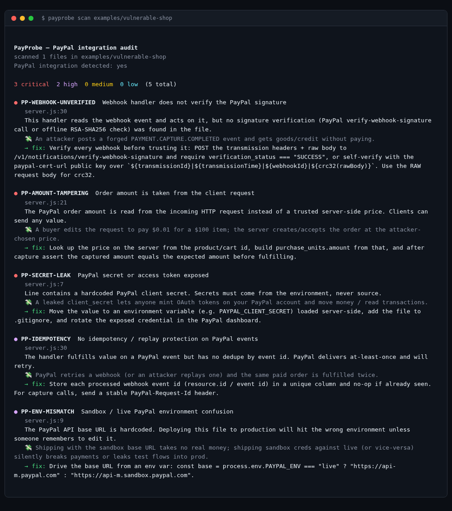
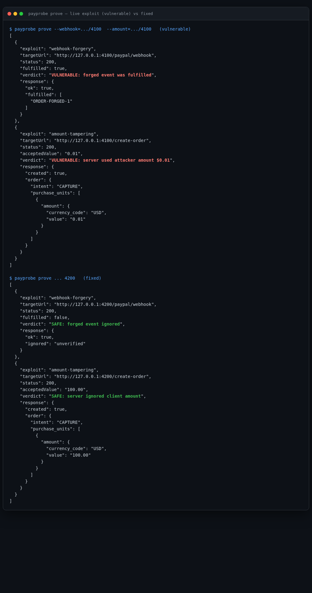
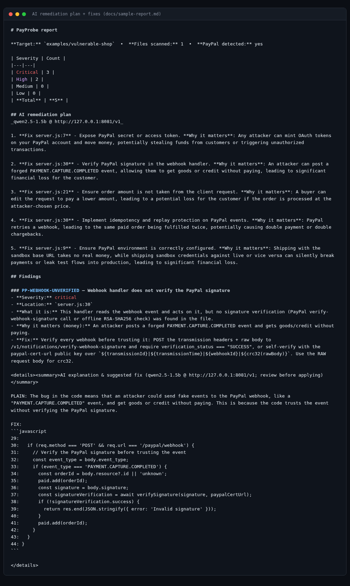
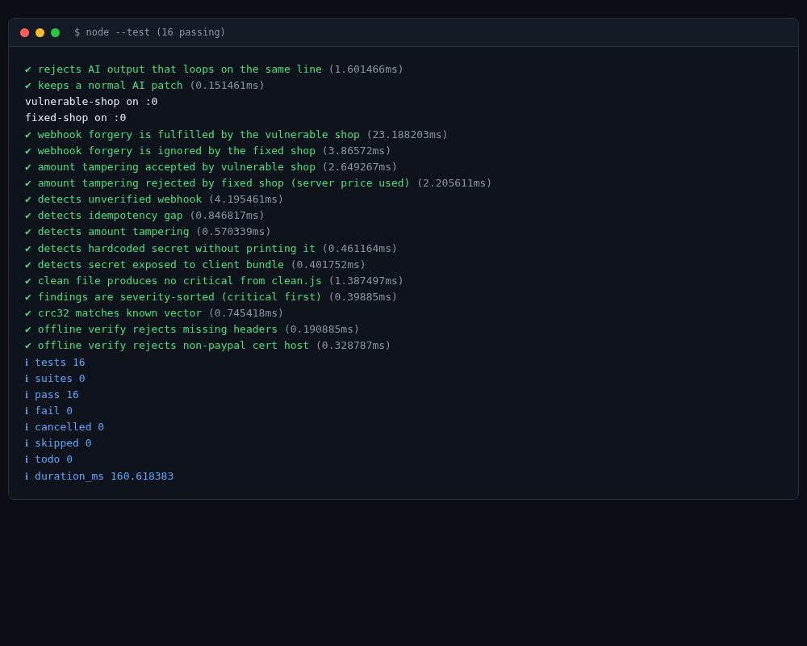

# PayProbe

PayProbe checks the PayPal code in an AI-built app for bugs that cost money, then shows each bug happening: it sends a forged webhook or a tampered price to the app and reports what the app did. For each finding it also suggests a fix.

It's a command-line tool for Node.js 20 or newer, with no dependencies to install. We built it for the [PayPal AI Hackathon](https://paypalaihackathon.devpost.com/), and it's MIT-licensed.

Why bother? AI assistants write PayPal checkouts that look fine and pass a manual test, but our demo shop, written the way those assistants often write it, fulfilled an order from a forged webhook and accepted $0.01 for a $100 item. Those are the bugs PayProbe is for.

## What it checks

`node src/cli.js scan <folder>` reads the code (no network, nothing to install) and reports these:

- `PP-WEBHOOK-UNVERIFIED`: the webhook handler acts on an event without checking PayPal's signature.
- `PP-AMOUNT-TAMPERING`: the order total comes from the request instead of a server-side price.
- `PP-IDEMPOTENCY`: no replay check, so a retried or replayed event fulfills the same order twice.
- `PP-SECRET-LEAK` and `PP-SECRET-IN-CLIENT`: a client secret in the source, or in a public env var that ends up in the browser bundle. PayProbe reports the file and line, never the value.
- `PP-ENV-MISMATCH`: a sandbox or live API URL hardcoded instead of picked from the environment.
- `PP-CLIENT-SIDE-ORDER`: orders created or captured in the browser with `actions.order.*`.

Then `prove` runs the attack against a URL you give it:

- **Webhook forgery.** It POSTs a forged `PAYMENT.CAPTURE.COMPLETED` event and reports whether the app fulfilled it.
- **Amount tampering.** It asks for a $100 item at $0.01 and reports the amount the server accepted.
- **Sandbox order** (`--sandbox`). It gets an OAuth token from the PayPal sandbox and creates an Orders v2 order the correct, server-side way.

The repo includes two copies of a small demo shop: `examples/vulnerable-shop`, written with the usual mistakes, and `examples/fixed-shop`, the same shop done right. Both are synthetic. The secret in the vulnerable shop is fake.

## Quick start (about 2 minutes, no accounts)

```bash
git clone https://github.com/pathakarchit/payprobe && cd payprobe

# 1) Scan the vulnerable demo shop: 3 critical, 2 high
node src/cli.js scan examples/vulnerable-shop
# The fixed shop comes back clean
node src/cli.js scan examples/fixed-shop

# 2) Start both shops and attack them
node examples/vulnerable-shop/server.js &   # http://127.0.0.1:4100
node examples/fixed-shop/server.js &        # http://127.0.0.1:4200
node src/cli.js prove --webhook=http://127.0.0.1:4100/paypal/webhook --amount=http://127.0.0.1:4100/create-order
node src/cli.js prove --webhook=http://127.0.0.1:4200/paypal/webhook --amount=http://127.0.0.1:4200/create-order
kill %1 %2   # stop the demo shops

# 3) Run the 16 tests (static rules, signature checks, live attacks, AI output guard)
node --test
```

To check your own app: `node src/cli.js scan /path/to/your/app`. Only point `prove` at an app you own (a local or staging copy).

### AI explanations and fixes (optional)

Without a model, PayProbe uses built-in explanations and fix text. With one, add `--ai` for a ranked fix plan and `--explain` for a plain-English explanation and a suggested patch per finding. Any OpenAI-compatible endpoint works.

```bash
# Local and free. We tested llama.cpp serving qwen2.5-1.5b-instruct (Q4_K_M):
export PAYPROBE_AI_BASE_URL=http://127.0.0.1:8081/v1   # llama-server --port 8081
export PAYPROBE_AI_MODEL=qwen2.5-1.5b
# Ollama serves the same API at http://127.0.0.1:11434/v1 (we haven't tested it)
node src/cli.js scan examples/vulnerable-shop --ai --explain --md --out=report.md

# Or a hosted endpoint (Groq free tier, OpenAI, ...):
export PAYPROBE_AI_BASE_URL=https://api.groq.com/openai/v1
export PAYPROBE_AI_KEY=...            # your key
export PAYPROBE_AI_MODEL=llama-3.3-70b-versatile
```

To see which backend is set, run `node src/cli.js ai-status`. [`docs/sample-report.md`](docs/sample-report.md) is a real report from the local qwen model above.

With that 1.5B model, the ranking and plain-English explanations were good and the patches were mixed. So every patch is labeled a suggestion to review. Small models sometimes loop and repeat one line until they run out of tokens; PayProbe spots that and falls back to its built-in fix text (`looksDegenerate` in `src/ai/explain.js`, with tests).

### PayPal sandbox (optional, needs a free PayPal developer account)

```bash
# developer.paypal.com > Apps & Credentials > Sandbox > create an app
export PAYPAL_ENV=sandbox
export PAYPAL_CLIENT_ID=...
export PAYPAL_CLIENT_SECRET=...
node src/cli.js prove --sandbox
```

This gets a sandbox OAuth token and creates one Orders v2 order. We ran it against a real sandbox app on Oct 30, 2026: the token came back and the order was created with status `CREATED`.

## How PayPal is used

- **OAuth 2.0 client credentials** against `api-m.sandbox.paypal.com` (`src/paypal/sandbox.js`).
- **Orders v2**, created and read on the server, with a `PayPal-Request-Id` header so retries don't create duplicates (`src/paypal/sandbox.js`).
- **Webhook signature verification**, two ways (`src/paypal/verify-webhook.js`). One posts to PayPal's `/v1/notifications/verify-webhook-signature`. The other checks the signature offline: RSA-SHA256 over `transmissionId|time|webhookId|crc32(rawBody)`, with the certificate URL pinned to a `paypal.com` host. The fixed demo shop uses the offline check to reject forged events.

If you verify webhooks yourself, compute the CRC-32 over the raw request bytes. Parsing the JSON and serializing it again changes the bytes, and the check fails.

## How AI is used

In the tool:

- `triage` in `src/ai/explain.js` ranks the findings by how much money each one can lose and turns them into a fix plan.
- `explainFinding` sends the code around one finding to the model and asks for a plain explanation and a minimal patch.
- `src/ai/provider.js` talks to any OpenAI-compatible API, and falls back to the offline text when none is set.

In building it: AI agents did the building and testing, with a person checking the work. The bugs we hit along the way (a small model inventing dollar figures, a model looping, tests clashing with the demo shops' ports) are fixed and covered above or in the tests.

## Project layout

```
src/
  cli.js          entry point (scan | prove | ai-status)
  scanner/        the scanner and its 6 rule files
  ai/             model provider, triage and explanations
  paypal/         sandbox client (OAuth, Orders v2) and webhook verification
  prover/         the live attacks
  report/         terminal, Markdown and JSON output
examples/
  vulnerable-shop the insecure demo shop
  fixed-shop      the same shop, done right
fixtures/         small snippets the scanner tests run against
test/             16 tests (node:test)
docs/             sample report and screenshots
```

## Safety and scope

- PayProbe never prints a secret's value. It reports where the secret is.
- It reads source code and talks only to the PayPal sandbox. It moves no real money.
- `prove` only attacks the URL you pass it.

## Screenshots

Scan of the vulnerable demo shop, 5 bugs found:


The two attacks: the vulnerable shop fulfills the forged webhook and accepts $0.01, the fixed shop rejects both:


The AI fix plan from the sample report:


The test run:


## Who made this

PayProbe is a [BuildWithThis](https://buildwiththis.com) project. BuildWithThis tests AI tools for vibe coding on the same app and publishes dated test logs. We're writing up how PayProbe was built and what broke along the way. It's coming soon on [buildwiththis.com](https://buildwiththis.com).

## License

MIT. See [LICENSE](LICENSE).
